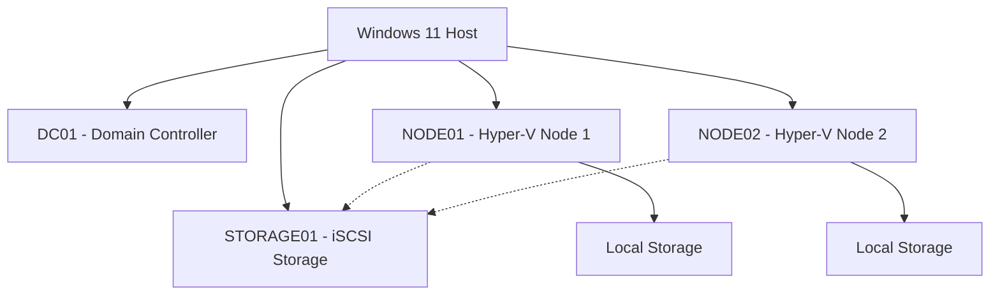


# Windows Server & Hyper-V Lab Architecture

## 1. Project Overview

A practical home lab documenting Windows Server administration, Hyper-V virtualization, Active Directory, iSCSI storage and infrastructure operations.

## 2. Lab Environment

| Server | Role | Status |
|---|---|---|
| DC01 | Domain Controller | Operational |
| NODE01 | Hyper-V Node 1 | Operational |
| NODE02 | Hyper-V Node 2 | Operational |
| STORAGE01 | iSCSI Storage Server | Operational |

## 3. Infrastructure Components

### DC01
- Intended role: Active Directory Domain Services
- DNS infrastructure
- Domain administration
- Domain configuration pending verification

### NODE01
- Hyper-V virtualization
- Virtual machine management
- Local storage
- iSCSI connectivity pending verification

### NODE02
- Hyper-V virtualization
- Virtual machine management
- Local storage
- iSCSI connectivity pending verification

### STORAGE01
- iSCSI Target Server
- Storage provisioning
- Storage configuration pending verification

## 4. Storage Architecture

The lab uses both local and iSCSI storage.

| Storage Component | Status |
|---|---|
| Local storage | Confirmed |
| iSCSI storage | Confirmed |
| Disk allocation | Pending verification |
| iSCSI sessions | Pending verification |
| Shared disk configuration | Pending verification |

## 5. Logical Architecture

This is a preliminary logical diagram. Actual network and storage connections must be verified.

## 6. Network Architecture

Pending verification:
- Virtual switch configuration
- Network adapter assignments
- IP addressing
- DNS configuration
- VM connectivity
- iSCSI connectivity

## 7. Virtualization Architecture

- Microsoft Hyper-V
- Two Hyper-V nodes
- Local storage
- iSCSI storage infrastructure

Failover Clustering configuration will be documented separately.

## 8. Verification Checklist

- [x] Four lab VMs operational
- [x] Local storage available
- [x] iSCSI storage available in the lab
- [ ] Active Directory domain verified
- [ ] Hyper-V switches documented
- [ ] IP configuration documented
- [ ] iSCSI sessions verified
- [ ] Shared storage mappings verified
- [ ] Failover Cluster validation documented

## 9. Security

- No passwords or credentials in the repository.
- No private keys or access tokens.
- Sanitize sensitive network information.
- Never publish confidential production configurations.

## 10. Project Objectives

1. Windows Server administration
2. Active Directory and DNS
3. Hyper-V virtualization
4. iSCSI storage management
5. Windows Failover Clustering
6. PowerShell automation
7. Professional infrastructure documentation

---

**Author:** Farhaad Shaikh

**GitHub:** https://github.com/shaikhfarhaad
